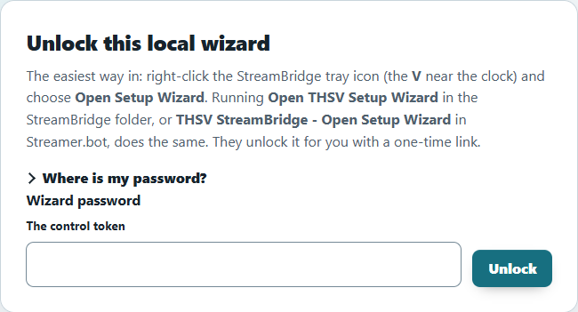
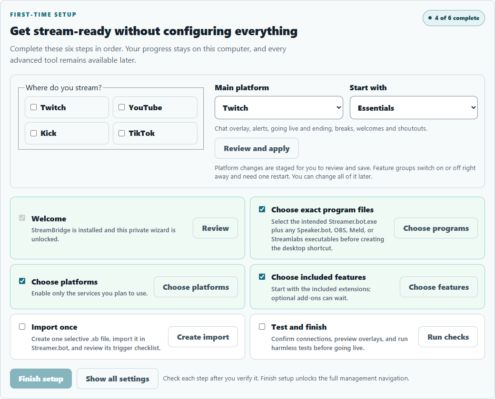
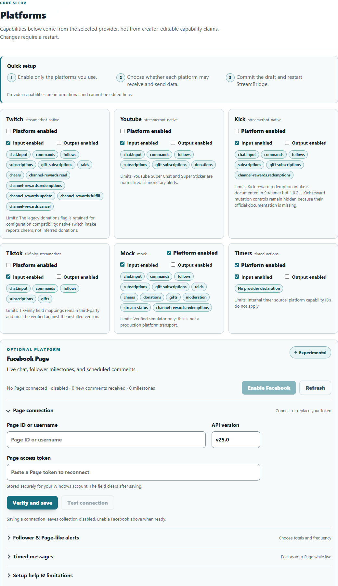
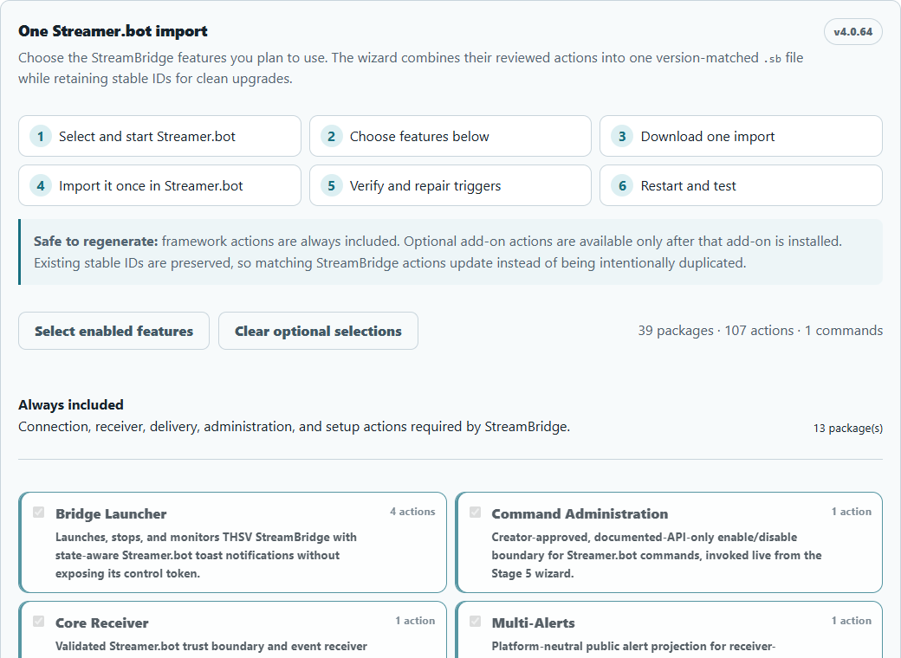
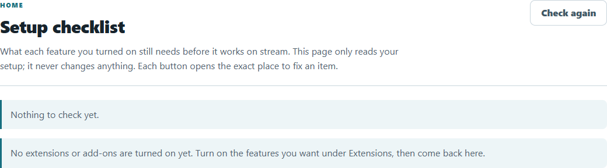
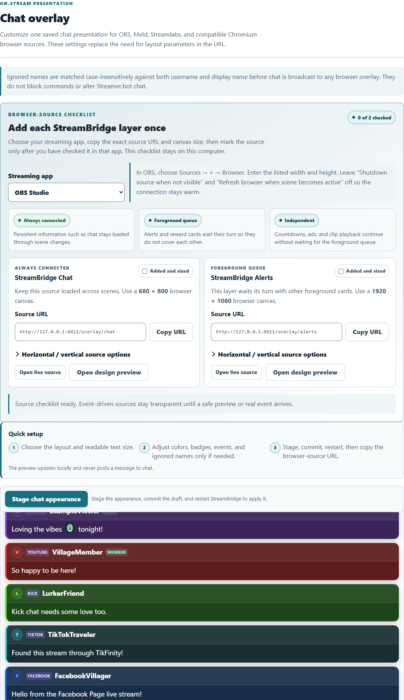
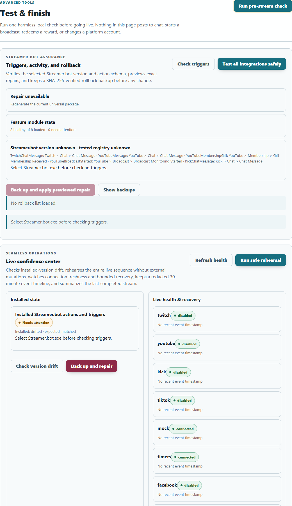

# Quick start: from download to your first alert

This is the one walkthrough to follow when you set up StreamBridge for the first time. It takes about 30 minutes. Each step links to a page with more detail if you need it, but you can do the whole setup from this page alone.

When you are done you will have chat from every platform in one place, alerts on stream, and the Setup Wizard telling you everything is ready.

## Before you start

You need:

- A Windows 10 or 11 PC (64-bit).
- [Streamer.bot](https://streamer.bot/) 1.0.7 or newer, with your Twitch, YouTube and/or Kick accounts already connected inside it.
- OBS Studio 28 or newer, Meld Studio or Streamlabs Desktop, if you want overlays on stream.
- TikFinity, only if you stream on TikTok.

You do **not** need Node.js, a database, coding, or any platform password. StreamBridge never asks for your Twitch, YouTube, Kick or TikTok password.

## Step 1. Turn on Streamer.bot's WebSocket server

1. Open Streamer.bot.
2. Go to **Servers/Clients > WebSocket Server**.
3. Set **Address** to `127.0.0.1`, **Port** to `8080` and **Endpoint** to `/`.
4. Turn on **Auto Start**, then select **Start Server**.

## Step 2. Download and install StreamBridge

1. Open the [latest release](https://github.com/surakage/THSV-StreamBridge/releases/latest) and download `THSV-StreamBridge-<version>.zip`.
2. Right-click the ZIP and choose **Properties**. If you see **Unblock**, tick it and select **OK**.
3. Extract the ZIP to a normal folder, for example your Downloads folder.
4. Double-click **Install THSV StreamBridge.cmd** and wait for `[SUCCESS]`. It does not need administrator access.

The installer puts StreamBridge in `%LOCALAPPDATA%\THSV StreamBridge`, starts it, adds a "V" icon to the Windows notification area, and opens the **Setup Wizard** in your browser. It also saves `THSV StreamBridge Recovery Key.txt` in that folder. Keep that file private and never show it on stream.

If Windows 11 Smart App Control blocks the installer, see [Install and first run](install-and-first-run.md).

**Opening the wizard later:** right-click the tray icon and choose **Open Setup Wizard**. It unlocks by itself. If the wizard ever asks for a password, choose **Copy Wizard password** in the same tray menu and paste it. To skip the password on this PC, open **Overview > Wizard unlock** and choose **Open without a password on this PC**.

## Step 3. Follow the First-time setup list

The wizard's **Overview** page shows a **First-time setup** list. Start with the **Start here** box at the top:

- **Where do you stream?** Tick only the platforms you use.
- **Main platform:** the one you stream on most. The wizard links you to its setup guide.
- **Start with:** **Essentials** (chat overlay, alerts, going live and ending, breaks, welcomes and shoutouts) is enough for most streamers. **Essentials + viewer fun** adds points, rewards, chat games, clips and giveaways. You can turn on more at any time.

Select **Review and apply**. Platform changes wait for you to save them; feature groups switch on or off straight away and need one restart.

Then work through the list in order:

1. **Choose exact program files.** On the **Streamer.bot** page, select **Detect automatically**. You can also pick OBS and other apps you want StreamBridge to open for you.
2. **Check platforms.** On **Platforms**, **Platform enabled** should be ticked only for the platforms you stream on. See [Platforms](platforms.md) for TikTok and Facebook.
3. **Check features.** On **Extensions**, the groups from **Start with** are on. Select **Enable group** for any others you want.
4. **Save.** Select **Save with backup**, then **Restart safely**. A fresh wizard window opens.

Lost the wizard? Double-click the tray icon, or open `http://127.0.0.1:8787/wizard/`.

## Step 4. Import into Streamer.bot (once)

1. In the wizard, open **Streamer.bot** and scroll to **One Streamer.bot import**.
2. Select **Select enabled features**, then **Create & download one import**. One `.sb` file downloads.
3. In Streamer.bot, select **Import** and drag the `.sb` file in. Accept the custom code warning only for files from your own wizard or the official release.
4. Close and reopen Streamer.bot once, so it saves the imported actions to disk.
5. Back in the wizard, select **I finished importing — verify now**.

The import already includes the platform triggers (chat, follows, subs, raids, rewards, stream online and offline). Do not add those again by hand, or events arrive twice. The **Recommended trigger checklist** lists the few triggers that depend on your setup, such as Stream Deck buttons.

**Updating later:** a new import can remove triggers you added yourself. Before you import an update, note the triggers on your THSV actions, and re-add them afterwards. More detail: [Streamer.bot import and approval](streamerbot-import-and-approval.md).

## Step 5. Approve the actions your features run

Some features run a Streamer.bot action, for example to switch scenes or turn on an OBS filter. They only run actions you approve.

1. Open **Setup checklist** (right under **Overview**). It lists every feature that still needs something.
2. For each **Approve actions** item, select its button, then **Approve recommended**.

Approvals take effect straight away. No restart needed.

If the wizard says actions or triggers are missing right after your import, Streamer.bot has not saved the import to disk yet. Wait a minute and check again, or close Streamer.bot normally (it saves on exit) and open it again.

## Step 6. Add the overlays to your streaming app

1. In the wizard, open **Chat Overlay > Browser-source checklist** and pick your streaming app.
2. For each source, copy the URL and use the width and height shown. In OBS: **Sources > + > Browser**, paste the URL, enter the size, and leave **Shutdown source when not visible** off.

The two you want first:

| Overlay | Address |
| --- | --- |
| Chat | `http://127.0.0.1:8787/overlay/chat` |
| Alerts | `http://127.0.0.1:8787/overlay/alerts` |

Features with their own overlay show their address on their wizard card. To let StreamBridge see your scenes (for break timers and scene-based features), connect your app under **Streamer.bot > Direct scene connections**. See [OBS and overlays](obs-and-overlays.md).

## Step 7. Test before you go live

1. On **Diagnostics**, select **Run pre-stream check**. Everything should be green.
2. On the **Alerts** page, pick an event and select **Fire test alert**. It is always simulated and should appear once in your streaming app. Feature overlays have a **Send safe preview** button in the **Browser-source checklist**.
3. Hover the tray icon. It should say **Bridge is ready**.

You are set. Before every stream, start your tools with **Start THSV Streaming Tools** (in the install folder, or on a Stream Deck button). See [Tray, launcher and Stream Deck](tray-launcher-and-stream-deck.md).

## Next steps

- Turn on more features: the [feature guide](README.md) has one page per feature.
- Set up rewards and points for every platform: [Points and !buy](points-and-buy.md).
- Updates and backups: [Updates, backups and recovery](updates-backups-and-recovery.md).
- Something not working: [Troubleshooting](../troubleshooting.md). When asking for help, attach the support bundle from **Diagnostics**. Never share your recovery key or tokens.
